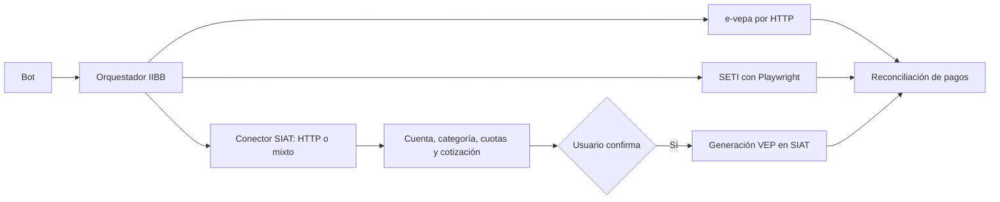

# Migración de Ingresos Brutos de Santa Fe a SIAT

Fecha de la investigación: 10 de septiembre de 2026 (ART).

Revisión del plan: 10 de septiembre de 2026. Objetivo obligatorio: recuperar todas las funcionalidades de IIBB que ya ofrece el bot. Las fases de lectura y cotización son hitos intermedios; no representan la finalización de la migración.

## Estado de implementación — 10/09/2026

**Implementación local completa del flujo de consulta, cotización y emisión; migración productiva todavía pendiente.** `SiatIibbConnector` ya está conectado en el código del worker e integra lectura, recotización, POST único y validación del PDF mediante `pypdf`, agregado con autorización de Federico. La emisión real autorizada fue verificada en SETI y su PDF fue validado por el lector final sin emitir otro VEP. No se modificaron ni reiniciaron los servicios productivos, y los cambios están sin stage ni commit.

Evidencia autenticada contra la cuenta real:

- El recorrido ARCA → `santafe_pwlocal` → representación → selección de cuenta → deuda → reimpresión → preparación del VEP se pudo reproducir por HTTP, leyendo acciones y campos de cada página. La navegación no requiere un navegador; `pypdf` se agregó exclusivamente para leer el comprobante devuelto por la emisión.
- SIAT devolvió 34 períodos y VEPAI 32 pagos. Próxima obligación: agosto de 2026, capital **$42.882**, intereses **$0**, vencimiento **18/09/2026**. No hay evidencia de que esta cuota haya sido pagada.
- El campo registral descriptivo de importe mensual todavía dice $28.300. El adaptador usa el impuesto de las obligaciones actuales, $42.882, no ese dato desactualizado.
- La pantalla de preparación sigue ofreciendo 1001 (Red Link), 1002 (Pago Mis Cuentas) y 1003 (Interbanking). El vencimiento oficial del VEP se guarda por separado de la fecha en que se cotizó.
- Una falla de VEPAI conserva la cuenta SIAT como consulta parcial. Los avisos de pago confirmado por SETI ya no necesitan un snapshot provincial fresco.
- Las pruebas locales cubren identidad, contrato de tablas, importes, formularios, cuotas pagadas, fallas parciales, fecha de expiración y avisos SETI. La suite final pasó: **243 pruebas**. `scripts/deployment_preflight.sh` pasó con los cambios finales: configuración renderizada, ambas imágenes construidas y escritura con el UID final en los volúmenes locales. Esto no equivale a un despliegue productivo validado.
- Una sesión HTTP tuvo un corte de respuesta durante la selección de representación; otra ejecución completa de lectura terminó correctamente. No se añadieron reintentos sobre operaciones de emisión.

Prueba real de emisión autorizada (10/09/2026):

- Antes de emitir se verificó que no había borradores de agosto en el bot ni VEP pendientes en la interfaz autenticada de SETI.
- Se envió **un solo POST**, sin reintentos ni seguimiento de redirecciones, al destino de emisión obtenido del formulario. Respuesta HTTP 200, `application/pdf`, 197.679 bytes. No se realizó ningún pago bancario.
- El PDF oficial informa **formulario 5439**, aunque el formulario de preparación contiene `nroFormulario=5426`. Concepto/subconcepto 19, período 2026-08, $42.882 y expiración 18/09/2026. No asumir que el número de formulario de preparación es el que imprime el servidor.
- La consulta posterior en SETI identifica el mismo número como **SF-RGS08/26**, **pendiente de pago**, enviado a **BANELCO**, por **$42.882**. La descripción vigente sigue siendo compatible con el clasificador existente de Régimen Simplificado.
- El PDF y sus metadatos están en `data/receipts/`, excluido de Git. Se revisó visualmente la página completa y se contrastaron sus campos. **Todavía no se importó ese VEP a los borradores productivos del bot**; debe hacerse antes de habilitar la generación, para que el mismo período quede protegido contra duplicados.
- El enlace autenticado vigente de consulta es `https://seti.afip.gob.ar/setiweb/#/pago/consulta-veps`; se corrigió el enlace anterior del bot.
- Se integró `pypdf>=6.18.0,<7` con autorización. El lector conserva los bytes originales, exige un único comprobante no cifrado y valida número, tipo, formulario, CUIT, período, concepto, total y expiración. El flujo recotiza inmediatamente antes de emitir y pide reconfirmación si cambian los importes o las fechas. La implementación nunca usa el endpoint retirado.
- Todo error posterior al POST queda como `UNKNOWN`, sin reintento. Se conserva el PDF recibido para revisión cuando cumple el límite de tamaño. Si falla el guardado de una emisión ya validada, también se conserva el número y se intenta registrar el estado incierto; no se vuelve a `QUOTED`. Si la base sigue inaccesible, la recuperación existente de trabajos `GENERATING` los deja como inciertos.
- Suite posterior a la emisión: **247 pruebas, todas correctas**. Las pruebas de envío usan respuestas sintéticas y no emiten VEP reales; comprueban las tres redes, POST único, ausencia de redirecciones/reintentos y rechazo de respuestas inesperadas.

Validación final de la integración de `pypdf`:

- **255 pruebas correctas en el entorno local y otras 255 dentro de la imagen final de `portal-worker` con Python 3.12**. Incluyen el circuito SIAT → cotización → confirmación → PDF → almacenamiento → reenvío, sin servicios externos reales.
- `scripts/deployment_preflight.sh` pasó con los cambios finales. Se construyeron ambas imágenes locales y se verificó escritura con UID 10001. La imagen de `bot` pudo importar `pypdf` 6.18.0 y los módulos de pagos con ese mismo usuario.
- `pip check`, compilación de módulos y `git diff --check` correctos. No se incorporaron datos fiscales reales a los fixtures ni se incluyeron los recibos en las imágenes.
- El lector final verificó el PDF real existente, sin modificarlo ni generar otro VEP.

Preparación del despliegue (sólo lectura):

- Identidad SSH verificada: hostname `winston`, usuario restringido `codex`, usuario administrativo `ffortu`.
- Los servicios `bot` y `portal-worker` del proyecto `kqx8azk1ldlc4iak7y57pdlp` siguen saludables con la revisión `3e1dcec69b984a01cdb625b55e4476adfcd4eb1a`.
- Datos persistentes: volúmenes `kqx8azk1ldlc4iak7y57pdlp_tax-data` → `/data` y `kqx8azk1ldlc4iak7y57pdlp_portal-state` → `/portal-state`.
- Las etiquetas de Compose apuntan al directorio efímero `/artifacts/llb4uhm1dulpmzyy8zciam3j`, que no existe en el host. El usuario `ffortu` recibió `Permission denied` al comprobar `/data/coolify/applications/kqx8azk1ldlc4iak7y57pdlp`. No se leyó ningún archivo de credenciales ni se intentó eludir ese control.
- **La propuesta ejecutable de despliegue/rollback no está cerrada:** falta una inspección administrativa supervisada de la configuración persistente. No se debe recrear los servicios suponiendo que el Compose local representa todos los valores productivos. Tampoco se deben introducir cambios efímeros dentro de los contenedores como sustituto silencioso del despliegue.

Pendiente obligatorio antes de declarar paridad:

1. Preparar propuesta exacta de despliegue/rollback y obtener aprobación para mutar Winston. La autorización de `pypdf` no autoriza recrear servicios ni escribir en la base productiva.
2. Incorporar de manera idempotente el VEP ya emitido a los borradores productivos antes de habilitar generación, con aprobación explícita del alcance de esa escritura, y comprobar su entrega por Telegram. No sobrescribir otros borradores ni perder el PDF. No volver a emitir agosto para probar.
3. Validar estados posteriores y mantenerlo como pendiente hasta observar un pago real. No simular ni declarar un pago bancario.
4. Validar los comandos y alertas en producción y observar ciclos programados. La independencia de VEPAI cuando falla SIAT y la contingencia de calendario siguen pendientes como mejoras de resiliencia; no están implementadas por el mero hecho de aislar SETI.

El resto del documento conserva la investigación y los criterios de aceptación; esta sección distingue el avance real de las tareas propuestas.

## Conclusión ejecutiva

La integración actual de Ingresos Brutos sí puede llamarse _scraping_ en sentido amplio, aunque técnicamente no controla un navegador. Usa `httpx` para iniciar sesión en ARCA, seguir formularios SSO ocultos, enviar los formularios privados del viejo sistema `e-regsim` y extraer datos desde tablas, texto e inputs HTML. Es una automatización de una interfaz web no documentada, no el consumo de una API oficial.

El sistema viejo dejó de prestar el servicio funcional: todavía responde HTTP 200, pero devuelve una página de “FUERA DE SERVICIO” que informa que Gestión de Régimen Simplificado fue incorporada a SIAT. El bot esperaba campos de deuda y recibió esa página informativa; por eso clasificó la respuesta como `UNEXPECTED_RESPONSE`. No fue un error de credenciales ni una caída general de ARCA.

Después de revisar la documentación pública de Santa Fe y ARCA, el portal ciudadano, el catálogo de web services, documentación OpenAPI accesible y el tráfico del nuevo SIAT durante un ingreso autenticado de solo lectura, **no encontré una API pública y documentada que un contribuyente pueda usar para consultar cuotas del Régimen Simplificado, calcular intereses o generar/reimprimir el VEP 5426**. Esto no prueba que no exista una interfaz privada o disponible mediante convenio; por eso conviene hacer una consulta formal a Santa Fe en paralelo.

La recomendación es:

1. Usar el VEP ya emitido y validado para la cuota inmediata, sin generar otro vigente. El pago bancario corresponde a Federico.
2. Usar el recorrido HTTP ya verificado de SIAT, incluida la preparación y emisión del VEP.
3. Mantener `e-vepa` y SETI como fuentes independientes para confirmar pagos.
4. Desplegar el flujo nuevo únicamente con aprobación y registrar primero el VEP emitido durante esta investigación.
5. Conservar todas las protecciones actuales: datos frescos, doble cotización, reconfirmación si cambia el importe, exclusión mutua, estado incierto y cero reintentos automáticos después de enviar una generación.

## Riesgo inmediato de vencimiento

El calendario oficial 2026 fija el vencimiento de la cuota 08 del Régimen Simplificado entre el **15 y el 18 de septiembre de 2026**, según el dígito verificador del CUIT. Al momento de esta investigación faltan entre cinco y ocho días. La fuente automática tiene como último dato válido el 31 de agosto de 2026 a las 18:42 ART, por lo que no debe usarse para decidir si la cuota está paga ni cuál es el importe vigente.

Acción operativa recomendada para hoy:

- Ingresar manualmente a SIAT y confirmar estado, importe y vencimiento de la cuota 08.
- Si sigue pendiente, pagar el VEP ya emitido y guardar el comprobante; no generar otro VEP vigente para probar.
- Confirmar después el pago en SETI o `e-vepa`.
- Mantener al bot sin generar VEP mientras la nueva integración no esté validada.

Fuente: [calendario impositivo oficial 2026, API Santa Fe](https://www.santafe.gob.ar/normativa/getFile.php?cod=0372111b5125702fd8224d004e3d4035&id=1613111&item=323695).

## Qué hace hoy la integración

### Autenticación

El autenticador de [`contador_ai/arca_http_auth.py`](contador_ai/arca_http_auth.py) hace lo siguiente:

1. Abre el formulario web de ARCA con el identificador del servicio solicitado.
2. Envía CUIT y clave fiscal mediante formularios HTML.
3. Sigue los formularios ocultos del relay SSO hasta `santafe.gob.ar`.
4. Conserva únicamente las cookies de sesión para que las use el conector.

No usa WSAA, certificado digital ni un web service oficial para esta integración.

### Cuenta, cuotas e importe

[`contador_ai/santa_fe.py`](contador_ai/santa_fe.py) usa el sistema anterior:

- Entrada: `https://www.santafe.gob.ar/e-regsim/index.php`.
- Menú: POST con `Ingreso::menu`.
- Cuenta y pagos: GET con `Registro::boletasPago`.
- Cotización de período: POST con `Registro::actualizarPeriodoVep`.
- Intereses: POST con `Registro::actualizarInteres`.
- Generación: POST con `Registro::liquidar_VEP`.
- Comprobante: descarga PDF con `ImpresionReportes::imprimirVEP`.

El código interpreta tablas y campos HTML como `fe_vencimi_periodo_vep` e `importe_periodo_vep`. Es un contrato inferido del sitio, sin versión ni garantía pública. Cuando la provincia cambió el contenido de la página, el parser dejó de encontrar esos campos y cortó correctamente.

### Confirmación de pagos

Existe un segundo flujo separado contra `https://www.santafe.gob.ar/e-vepa/index.php`. Consulta pagos por CUIT, cuenta y rango de fechas, y también parsea HTML. En la revisión del 10 de septiembre este servicio seguía funcionando.

Además, el bot consulta SETI mediante una combinación: Playwright hace el ingreso y abre el servicio; después `seti.request.get(...)` consulta el endpoint privado JSON `setiweb/api/pagos` usando las cookies del mismo contexto. Esto permite reconocer VEP de Santa Fe y confirmar su estado desde otra fuente. CCMA combina autenticación HTTP con navegación y cálculo de cuenta mediante Playwright.

### Complejidad incremental de Playwright

Playwright ya está declarado en `requirements.portal.txt` y `Dockerfile.portal` instala Chromium con sus dependencias. CCMA, SETI e IIBB se ejecutan dentro del mismo `portal-worker`. Por tanto, esta alternativa no necesita agregar una librería ni un servicio de navegador externo.

Sí agrega trabajo y consumo: otro recorrido que mantener, arranques de Chromium, tiempos de espera y memoria mientras se consulta. No medimos todavía el incremento de CPU, memoria ni duración en SIAT, así que no se puede afirmar que sea despreciable. El worker procesa operaciones de forma secuencial en su bucle principal; una navegación lenta puede retrasar las otras tareas. La validación debe medir ese efecto y poner un tiempo máximo por operación.

El patrón mixto ya está probado en el código de SETI. Playwright permite que las consultas HTTP compartan cookies con el navegador, aunque eso no sincroniza automáticamente el DOM o cualquier estado de navegación que SIAT guarde en el servidor. Se deben respetar las transiciones y descartar páginas desactualizadas. [Documentación oficial de APIRequestContext](https://playwright.dev/python/docs/api/class-apirequestcontext).

### Protecciones que ya existen y deben preservarse

- Verificación de que la credencial guardada pertenece al CUIT representado.
- Rechazo de un número de cuenta diferente al informado por Santa Fe.
- La generación sólo se habilita con un snapshot fresco.
- La cotización se repite inmediatamente antes de crear el VEP.
- Si vencimiento, capital, interés o total cambiaron, se exige una nueva confirmación.
- Una operación por cuenta/período a la vez.
- Ante timeout o respuesta ambigua después del POST, el estado pasa a `UNKNOWN` y no se reintenta automáticamente.
- El bot genera un VEP, pero no ejecuta el pago bancario.
- Los pagos se reconcilian posteriormente con `e-vepa` y/o SETI.

## Qué cambió en Santa Fe

La página vieja autenticada ahora informa que Gestión de Régimen Simplificado fue incorporada al **Sistema Integral de Administración Tributaria (SIAT)**. La documentación pública vigente también dirige el acceso tributario hacia SIAT y exige CUIT, clave fiscal nivel 3 y el servicio de ARCA “API - Santa Fe - Sistema Tributario - Contribuyentes”. La relación necesaria ya está habilitada para el usuario revisado: el ingreso autenticado y la selección de representación funcionaron sin cambiar nada.

Hay documentación pública contradictoria durante la transición:

- La [página vigente de Régimen Simplificado](https://www.santafe.gob.ar/index.php/web/content/view/full/211373/%28subtema%29/102284) todavía menciona el acceso histórico y confirma que el VEP 5426 se genera desde la aplicación.
- Las [preguntas frecuentes de SIAT](https://www.santafe.gob.ar/index.php/web/content/view/full/224189/%28subtema%29/102284) describen el servicio unificado y la nueva relación de ARCA.
- El [trámite ciudadano de acceso a SIAT](https://www.santafe.gob.ar/gestionesciudadanas/tramite/69037f3769db4c3a29bdf9c1) está publicado como gestión online.
- Algunas páginas del portal anterior todavía muestran “Actualmente este trámite no está disponible para ser realizado online”. No deben tomarse como indicador del estado real del nuevo SIAT.

La [Resolución General 43/2024](https://www.santafe.gob.ar/boletinoficial/ver.php?seccion=2025%2F2025-01-21avisos.html) establece que la aplicación —o la que la sustituya en el futuro— debe soportar categorización, modificaciones, pago y generación del VEP 5426. Es decir, la función no fue eliminada normativamente; fue trasladada.

## Cómo funciona técnicamente el nuevo SIAT

La inspección autenticada, realizada en modo de solo lectura el 10 de septiembre, mostró:

- `https://www.santafe.gob.ar/siat/` inicia un POST hacia `/siat/app/afip/pwlocal`.
- ARCA recibe el nuevo identificador de servicio `santafe_pwlocal`.
- Después de autenticar hay selección de persona representada.
- El menú expone “Régimen Simplificado” e “Ingresos Brutos”.
- Las rutas internas incluyen acciones de adhesión, modificación y cese del Régimen Simplificado.
- La aplicación usa páginas HTML con sesión de servidor y acciones dinámicas que cambian por sesión/página.
- Durante el login, selección y menú no hubo llamadas XHR/fetch ni respuestas JSON: todo fueron navegaciones y formularios HTML.
- El JavaScript público del sitio es principalmente un helper que construye y envía formularios GET/POST.

También se probaron las ubicaciones convencionales de Swagger/OpenAPI (`/swagger-ui`, `/v3/api-docs`, `/openapi.json`, `/swagger.json`) sin encontrar documentación pública.

La comprobación posterior llegó hasta la emisión real autorizada: un único POST devolvió directamente el PDF oficial y SETI confirmó el mismo número como SF-RGS08/26, pendiente de pago en BANELCO. La extracción final mediante `pypdf` fue validada contra ese archivo. Siguen pendientes el despliegue, la incorporación al registro del bot y la validación posterior de un pago bancario real.

El 10 de septiembre se volvió a consultar el HTML público de entrada por HTTP: contiene un formulario POST y un JavaScript que sólo lo envía. Ese paso no exige un navegador. Tampoco las rutas dinámicas lo exigen por sí solas: se pueden extraer de cada respuesta HTML junto con los campos ocultos y tokens. Su coste real depende de cuánta lógica y estado haya que reproducir. La recomendación anterior de empezar necesariamente con Playwright era más concluyente que la evidencia disponible.

Playwright sigue siendo una alternativa razonable y ya disponible, pero hay que elegir por funcionalidad después de observar el flujo completo.

## Alternativas investigadas

| Alternativa | Resultado | Decisión |
|---|---|---|
| API pública de SIAT para deuda/Régimen Simplificado | No apareció en documentación oficial, tráfico del frontend ni rutas OpenAPI convencionales. | Consultar formalmente; no bloquear la continuidad esperando que exista. |
| Web services de padrón de ARCA | Informan situación registral nacional, no la deuda mensual ni el VEP provincial de Santa Fe. | No resuelve el caso. |
| `sud_restricciones` de ARCA | Consulta genérica de deuda, pero ARCA indica que está reservada a entidades bancarias. | No accesible ni suficientemente detallada. |
| `SETIWS-PAGO-API` | API REST moderna para crear, enviar y consultar VEP; admite idempotencia y QR. Exige que el organismo consumidor tenga convenio de intercambio vigente con ARCA y especificaciones Osiris para cada formulario. | No es una API de autoservicio para este bot. Sólo sería opción si Santa Fe/ARCA autorizan formalmente la integración. |
| Automatización HTTP de SIAT | Es más liviana; debe descubrir formularios, acciones, campos ocultos y tokens en cada respuesta. No necesita que las URLs sean constantes. | Preferirla si la prueba reproduce el flujo sin reimplementar lógica importante de JavaScript. |
| Automatización de SIAT con Playwright | Conserva sesión y ejecuta JavaScript; ya está instalado. Añade navegación y consumo de navegador. | Usarlo donde la prueba demuestre que evita complejidad o que HTTP no alcanza. |
| Navegador + HTTP en la misma sesión | SETI ya usa este patrón; puede reducir navegación manteniendo el estado de autenticación. | Opción provisional preferida si SIAT realmente requiere navegador en algunas transiciones. |
| `e-vepa` + SETI | Ambas aportan evidencia independiente del pago y hoy siguen disponibles. | Mantenerlas como reconciliación y defensa ante fallas parciales. |

Fuentes de ARCA: [catálogo oficial de web services](https://www.arca.gob.ar/ws/documentacion/catalogo.asp) y [manual SETIWS-PAGO-API v1.1.1](https://www.arca.gob.ar/ws/SETIWS-PAGO-API/Manual_para_el_desarrollador_setiws-pago-api.pdf).

Una ambigüedad importante: en el sitio provincial, “API” normalmente significa **Administración Provincial de Impuestos**. Una URL como `santafe.gov.ar/api` o el nombre “API-SIAT” no indica que exista una Application Programming Interface.

## Selección del método: prueba antes de decidir

La decisión busca minimizar mantenimiento total y fallas, además de CPU o cantidad de líneas. No se van a desarrollar dos conectores completos ni un fallback automático entre transportes de generación.

1. Recorrer manualmente la función objetivo y observar las peticiones, sin confirmar trámites. Clasificar cada respuesta como HTML, JSON o documento.
2. Para lectura y cotización, probar si el flujo puede seguirse mediante HTTP leyendo los formularios devueltos por el servidor. No reutilizar identificadores de otra sesión ni inventar acciones.
3. Repetir en al menos tres sesiones nuevas, con sesión expirada y con períodos diferentes. Comparar valores, solicitudes, duración y necesidad de lógica especial.
4. Si HTTP reproduce el resultado con una secuencia simple, elegir `httpx` para esa capacidad. Si necesita lógica compleja de JavaScript o eventos de navegador, usar Playwright allí.
5. Si aparece un endpoint JSON privado del módulo, evaluarlo dentro de la sesión existente, como SETI. Que responda JSON no lo convierte en una API pública soportada.
6. Registrar la decisión y sus evidencias en una tabla por capacidad: cuenta, cotización, emisión, PDF y consulta posterior. La emisión se verifica con fixtures y luego con una única generación real expresamente autorizada; no se emiten VEP de prueba duplicados para comparar transportes.

La prueba termina con una elección concreta y una lista de brechas. Si no se puede localizar la liquidación o el VEP en SIAT, la migración sigue incompleta y se investiga el canal oficial que lo reemplaza. No se da por resuelto por haber logrado iniciar sesión.

## Arquitectura propuesta

La prueba seleccionó HTTP para lectura, cotización y emisión. La respuesta real de emisión es directamente un PDF, validado con `pypdf`; no hay una descarga HTML intermedia. La separación entre consulta, emisión y reconciliación está definida.

El conector nuevo debe respetar el contrato de datos que ya consume el bot (`account`, `category`, `monthly_amount`, `effective_period`, `period_quotes`, `next_obligation`, `vepai`). Así el cambio queda concentrado en la frontera con Santa Fe y no obliga a reescribir comandos, recordatorios ni conciliación.

También hay que conservar `regime`, `status`, `activity_start`, `adhesion_date`, `declared_annual_income`, `payments`, `payments_as_of` y las fechas de actualización cuando estén disponibles. No se completará un dato ausente usando silenciosamente un valor viejo; cada brecha debe tener una fuente oficial alternativa o quedar expresamente pendiente.

Conviene separar explícitamente tres capacidades:

1. `fetch_siat_profile`: sólo lectura de identidad tributaria, cuenta, régimen y categoría.
2. `quote_siat_payment`: sólo lectura/cálculo oficial de período, capital, interés, total y vencimiento.
3. `generate_siat_vep`: operación con efecto externo, habilitada después y con confirmación humana.

## Cobertura obligatoria de funcionalidades

Inventario contrastado con `santa_fe.py`, `service.py`, `notifications.py`, `iibb_payment.py` y sus tests. Estado actual de esta revisión: la paridad con SIAT todavía no fue verificada. Esta tabla es el criterio de aceptación, no una afirmación de que las funciones ya estén recuperadas.

| ID | Función que ya tiene el bot | Qué debe comprobar la migración |
|---|---|---|
| F01 | Ingreso con acceso guardado y verificación de CUIT/cuenta | Acceso SIAT renovable y rechazo de otra identidad; sin romper CCMA/SETI. |
| F02 | `/iibb`: régimen, estado, categoría, cuota y adhesión | Datos actuales equivalentes; conservar también los campos internos usados para conciliación. |
| F03 | Cotización del mes anterior y actual | Período, capital y vencimiento oficiales, incluido el cambio de mes/año. |
| F04 | Próxima obligación y detección de vencidos | Elegir la cuota pendiente correcta y excluir pagos confirmados. |
| F05 | Historial de pagos | Períodos, fechas, capital, accesorios y agrupación de pagos VEPAI. |
| F06 | Conciliación histórica desde el inicio del régimen | Identificar períodos sin pago y mantener estados parcial/mantenimiento; no equiparar ausencia de evidencia con deuda confirmada. |
| F07 | Resumen, próximos vencimientos y alertas de IIBB | Mismos datos en todos los comandos; recordatorios deduplicados y advertencia de fuente desactualizada. |
| F08 | Cotización para pagar: capital, intereses, total y fecha | Usar cálculo oficial; conservar validación de fecha y reconfirmación si cambió el total. |
| F09 | Selección de Santander/Pago Mis Cuentas, Red Link e Interbanking | Verificar las tres redes en SIAT; mapear valores nuevos si difieren de 1002/1001/1003. |
| F10 | Confirmar y cancelar preparación | Ninguna emisión antes de confirmar; doble clic y callbacks viejos no duplican operaciones. |
| F11 | Generación de VEP y envío de número/PDF por Telegram | Un VEP verificable, archivo válido, cuota/importe/red correctos y entrega recuperable. |
| F12 | Indicaciones y acceso a ARCA para pagar, incluido enlace a QR | Preservar enlaces útiles y verificar que el VEP nuevo sea compatible; el bot no genera QR propio actualmente. |
| F13 | Estados generado, incierto, vencido y pagado | Conservar borradores y VEP existentes, recuperación tras reinicio y ausencia de reintentos ambiguos. |
| F14 | Pago confirmado en SETI antes de imputación provincial | Verificar descripción, formulario y período del VEP nuevo; mantener enlace por número de VEP guardado. |
| F15 | Avisos de pago confirmado y posterior imputación | No repetir alertas ni pedir pagar de nuevo cuando SETI ya lo confirmó. |
| F16 | Autorización por chat y bloqueo con datos desactualizados | Mismas restricciones en bot y worker, aun con botones antiguos. |

Dos límites del alcance anterior que conviene mantener claros: el botón de pago ofrece la próxima obligación detectada; no era un selector general de cualquier período histórico. Adhesión, recategorización y baja en Santa Fe tampoco eran funciones del bot. Restaurarlas no forma parte de esta migración porque nunca estuvieron implementadas.

La reimpresión remota de un VEP histórico es una mejora deseable para resolver estados inciertos. La función existente que sí debe conservarse es reenviar el PDF oficial ya guardado por el bot.

## Plan de implementación

### Fase 0 — continuidad de pago

Objetivo: que la migración no genere un atraso real.

- Verificar la cuota 08 manualmente en SIAT antes del vencimiento aplicable.
- Guardar VEP y comprobante fuera del bot para este ciclo si todavía está pendiente.
- Confirmar el pago mediante SETI o `e-vepa`.
- Mantener deshabilitada la generación automática desde la integración rota.
- Cambiar luego el aviso del bot para distinguir “migración del sitio” de una caída temporal y mostrar la ventana oficial de vencimiento, sin inventar importe ni estado.

Criterio de salida: la obligación inmediata quedó confirmada como paga o programada por el canal oficial.

### Fase 1 — descubrimiento controlado de SIAT

Objetivo: documentar el contrato real sin confirmar ninguna declaración ni generar un VEP.

- Registrar navegación, nombres visibles, roles, formularios y transiciones hasta la pantalla previa a una acción.
- Identificar dónde SIAT muestra cuenta, categoría, período vigente, deuda, vencimiento e importe.
- Capturar fixtures HTML sanitizados, sin CUIT, nombre, domicilio, cookies ni tokens.
- Registrar una firma estructural de cada pantalla para detectar cambios futuros.
- Definir de manera explícita qué botones son de lectura y cuáles crean, modifican o confirman algo.
- Preparar la consulta formal a Santa Fe; enviarla sólo si Federico lo autoriza. Su respuesta puede mejorar la elección, pero no bloquea la investigación técnica.
- Ejecutar la comparación HTTP/Playwright indicada arriba y completar el mapa F01–F16, incluyendo las funciones que aún no se pudieron localizar.

Criterio de salida: mapa reproducible del flujo, elección justificada por capacidad y brechas explícitas. La exploración debe evitar confirmar operaciones; no se inferirá ausencia de efectos simplemente porque no hubo error.

### Fase 2 — conector de solo lectura

Objetivo: recuperar `/estado`, `/iibb` y alertas sin habilitar VEP.

- Soportar el ingreso por `santafe_pwlocal` con el mecanismo validado en la fase 1.
- Crear un adaptador SIAT acotado usando el transporte elegido. Reutilizar el almacenamiento y procesamiento de pagos existentes; no crear un framework genérico de navegación.
- Elegir elementos por texto, label y rol; no hardcodear identificadores dinámicos de ruta.
- Validar CUIT representado y número de cuenta antes de aceptar datos.
- Mantener contexts de navegador efímeros y cerrar siempre la sesión.
- Emitir etapas de error específicas: entrada, autenticación, representación, menú, cuenta, períodos y contrato HTML.
- Nunca guardar el HTML completo ni screenshots con datos fiscales en logs.
- Adaptar la respuesta al esquema actual y conservar `e-vepa` para pagos.

Criterio de salida: varias ejecuciones consecutivas reproducen manualmente cuenta, categoría, período, importe y vencimiento; ante cualquier diferencia el bot falla cerrado.

### Fase 3 — pruebas y ejecución en sombra

Objetivo: validar antes de usar los datos para decisiones.

- Tests unitarios con fixtures sanitizados de pantalla normal, mantenimiento, sesión vencida, representación múltiple y cambio de contrato.
- Test de integración de solo lectura, habilitado explícitamente y fuera de la suite normal.
- Comparación manual entre SIAT y snapshot nuevo para el período actual.
- Ejecutar el conector nuevo en sombra: almacena métricas técnicas, pero no reemplaza alertas ni ofrece pagos.
- Verificar que una falla de SIAT no invalide los resultados saludables de SETI o `e-vepa`.
- Medir duración por operación, memoria máxima y retraso de las otras tareas del worker. Para lecturas, validar tres sesiones nuevas y luego tres ciclos programados consecutivos; esos controles son una puerta de salida inicial, no una garantía de estabilidad futura.

Criterio de salida: datos coincidentes, errores comprensibles y cero acciones externas.

### Fase 4 — cotización de VEP

Objetivo: permitir que el bot muestre una cotización oficial sin generarla.

- Navegar al período solicitado y obtener capital, interés, total, fecha de pago y vencimiento desde SIAT.
- No calcular localmente lo que el servidor pueda calcular; el bot sólo normaliza y compara.
- Repetir cotizaciones para detectar resultados no deterministas.
- Caducar cotizaciones rápidamente y volver a consultarlas antes de confirmar.

Criterio de salida: el total coincide con SIAT para cuota en término y vencida, y las variaciones obligan a reconfirmar.

### Fase 5 — generación de VEP con guardas

Objetivo: recuperar la generación sin riesgo de duplicados silenciosos.

- Mantener allowlist y feature flag separados de la lectura.
- Mostrar período, capital, interés, total, fecha y red antes de confirmar.
- Volver a cotizar inmediatamente antes del envío.
- Capturar el número de VEP y el PDF o comprobante equivalente.
- Si la respuesta posterior al clic es ambigua, marcar `UNKNOWN`, no reintentar y buscar el VEP en SIAT/SETI antes de permitir otra operación.
- Implementar primero reimpresión/consulta de VEP existente si SIAT la ofrece; es la mejor herramienta contra duplicados.
- Verificar vencimiento del VEP y descripción/formulario que llega a SETI. La expresión actual `SF-RGSMM/AA` podría cambiar; no asumir que los VEP nuevos se reconocen sin adaptar la conciliación.
- No automatizar el pago bancario.

Criterio de salida: una operación controlada genera exactamente un VEP verificable y todos los escenarios ambiguos terminan cerrados.

### Fase 6 — corte y rollback

- Activar primero lectura SIAT y mantener generación apagada.
- Activar VEP sólo después de la validación anterior.
- Conservar temporalmente el conector `e-regsim` detrás de una bandera, sin usarlo mientras la página continúe fuera de servicio.
- Si cambia SIAT, desactivar sólo su capacidad afectada: lectura, cotización o generación.
- Volver automáticamente al modo informativo/manual; nunca volver a un monto viejo.

Criterio final de salida: F01–F16 verificadas mediante tests y evidencia oficial donde corresponda; al menos un flujo real autorizado de cotización → generación → PDF → pago realizado por Federico → confirmación SETI → imputación provincial. Si la imputación tarda, se informa como validación pendiente. Rehabilitar sólo `/iibb` no alcanza para declarar completada la migración.

No se borran borradores, comprobantes, historial ni deduplicación durante el corte. La reversión técnica consiste en apagar el adaptador nuevo y mantener el historial accesible; `e-regsim` retirado no es una alternativa funcional de rollback.

## Continuidad de alertas ante futuras caídas

La revisión del código encontró dos acoplamientos relevantes para el objetivo de no atrasarse:

- `SantaFeIibbConnector.sync()` consulta Régimen Simplificado antes de VEPAI. Si falla lo primero, no llega a renovar VEPAI, aunque ese servicio funcione por separado.
- En `notifications.py`, el aviso de pago de IIBB reconocido en SETI está dentro del bloque que exige un snapshot IIBB fresco. Puede omitirse ese aviso cuando SIAT está caído, aunque SETI tenga el pago.

El plan debe desacoplar esas capacidades con fechas de actualización propias. Se puede usar una cuenta previamente verificada para consultar sus pagos, validando la identidad; eso no habilita reutilizar una cuota vieja para generar VEP.

También se propone un recordatorio de respaldo basado en calendario oficial versionado y dígito de CUIT. Con el portal caído debe decir que se aproxima una fecha del calendario y que el estado/importe están sin confirmar. Si hay evidencia confiable de pago del período, no debe pedir pagarlo otra vez. El calendario requiere fuente, año, fecha de revisión y tratamiento de prórrogas; no sirve una regla fija de “vence siempre el día X”. Esta mejora cubre la falla observada, pero no sustituye el cálculo del portal.

## Matriz mínima de pruebas

| Caso | Resultado esperado |
|---|---|
| Login válido y una representación | Llega al menú correcto y valida identidad. |
| Varias representaciones | Selecciona sólo el CUIT solicitado. |
| Credencial rechazada o relación ausente | Error explícito, sin reintentos agresivos. |
| Página de mantenimiento | `EXTERNAL_UNAVAILABLE`, sin interpretar datos viejos como actuales. |
| HTML o navegación cambiados | `UNEXPECTED_RESPONSE` en una etapa precisa. |
| Período sin deuda | No ofrece generar VEP. |
| Cuota vencida | Usa el interés calculado por SIAT. |
| Total cambia antes de generar | Cancela el envío y pide reconfirmación. |
| Timeout después de confirmar | Estado `UNKNOWN`; no reintenta. |
| VEP ya existente | Reutiliza/reimprime o exige resolución explícita. |
| SIAT falla pero SETI/`e-vepa` funcionan | Conserva la evidencia de pagos y marca sólo la fuente faltante. |

## Observabilidad y seguridad

- Métricas separadas por etapa y capacidad, no un único “falló IIBB”.
- Alertar por cambio de contrato después de una confirmación corta, pero avisar inmediatamente si se acerca un vencimiento y no hay snapshot fresco.
- No registrar credenciales, cookies, tokens, CUIT completo, HTML fiscal ni capturas de pantalla.
- Guardar sólo datos normalizados necesarios y fixtures artificiales/sanitizados.
- Limitar concurrencia por contribuyente; SIAT es stateful y una misma sesión no debe compartir operaciones.
- User-Agent identificable y frecuencia conservadora si Santa Fe confirma que la automatización está permitida.

## Consulta formal pendiente a Santa Fe

Canales publicados: `regimensimplificado@santafe.gob.ar` y `apipadronweb@santafe.gob.ar`.

Preguntas concretas:

1. ¿SIAT dispone de un web service o API documentada para contribuyentes/representantes que permita consultar cuenta, categoría, cuotas, deuda e intereses del Régimen Simplificado?
2. ¿Existe una interfaz soportada para generar, consultar y reimprimir el VEP Formulario 5426?
3. ¿El acceso requiere convenio con API Santa Fe o ARCA, certificado, homologación o una autorización especial?
4. ¿Está permitido automatizar el portal SIAT mediante navegador para uso propio del contribuyente?
5. ¿Hay ambiente de homologación, límites de frecuencia, ventana de mantenimiento y canal de aviso de cambios?
6. ¿Existe documentación específica para estudios contables o representantes de múltiples CUIT?

Si ofrecen una API soportada con acceso razonable, se prioriza sobre Playwright. Si sólo existe mediante convenio institucional, se evalúa como evolución futura y se continúa con el conector web controlado.

## Decisión recomendada

No conviene intentar adaptar a ciegas los POST del sistema anterior: los nombres de acción y campos pertenecen a `e-regsim` y ya no existen en SIAT. Tampoco conviene frenar la solución esperando una API pública que hoy no está documentada.

La decisión confirmada es **HTTP para SIAT, `pypdf` para validar su comprobante y `e-vepa`/SETI para reconciliar pagos**. Playwright sigue donde ya se usaba en CCMA/SETI; SIAT no necesita un navegador adicional. La implementación local está probada, pero la migración sólo se completa con despliegue aprobado, registro del VEP existente y verificación de los comandos, alertas y estados de pago en producción.

## Fuentes principales

- [Régimen Simplificado — Gobierno de Santa Fe](https://www.santafe.gob.ar/index.php/web/content/view/full/211373/%28subtema%29/102284)
- [Preguntas frecuentes del Régimen Simplificado](https://www.santafe.gob.ar/index.php/web/content/view/full/224945/%28subtema%29/)
- [Preguntas frecuentes de SIAT](https://www.santafe.gob.ar/index.php/web/content/view/full/224189/%28subtema%29/102284)
- [Acceso ciudadano a SIAT](https://www.santafe.gob.ar/gestionesciudadanas/tramite/69037f3769db4c3a29bdf9c1)
- [Resolución General API 43/2024 y VEP 5426](https://www.santafe.gob.ar/boletinoficial/ver.php?seccion=2025%2F2025-01-21avisos.html)
- [Calendario impositivo 2026](https://www.santafe.gob.ar/normativa/getFile.php?cod=0372111b5125702fd8224d004e3d4035&id=1613111&item=323695)
- [Catálogo de web services de ARCA](https://www.arca.gob.ar/ws/documentacion/catalogo.asp)
- [Manual SETIWS-PAGO-API v1.1.1](https://www.arca.gob.ar/ws/SETIWS-PAGO-API/Manual_para_el_desarrollador_setiws-pago-api.pdf)
- Inspección autenticada de solo lectura del entorno productivo y del SIAT, 10 de septiembre de 2026; sin persistir credenciales, cookies, HTML ni datos personales.
